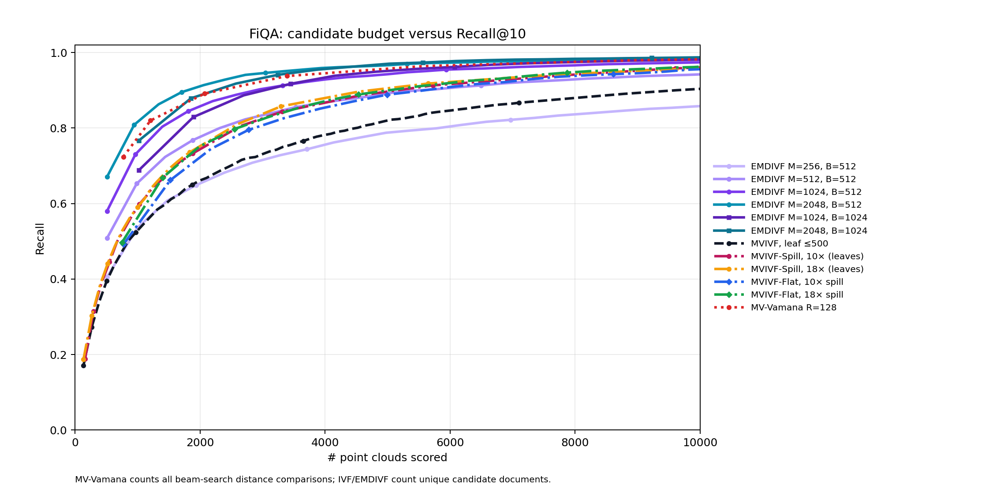
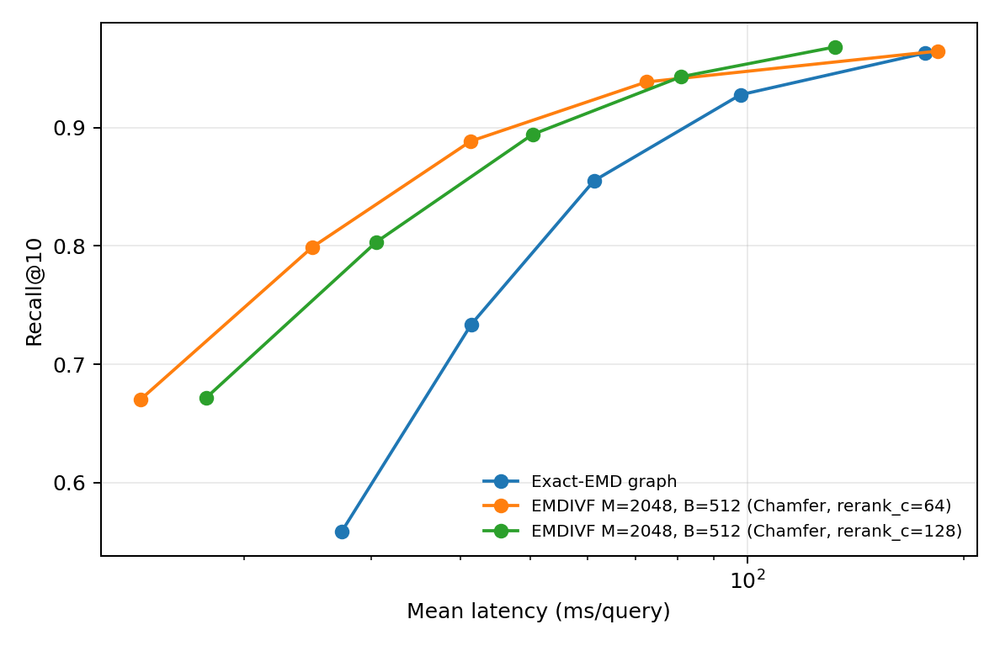
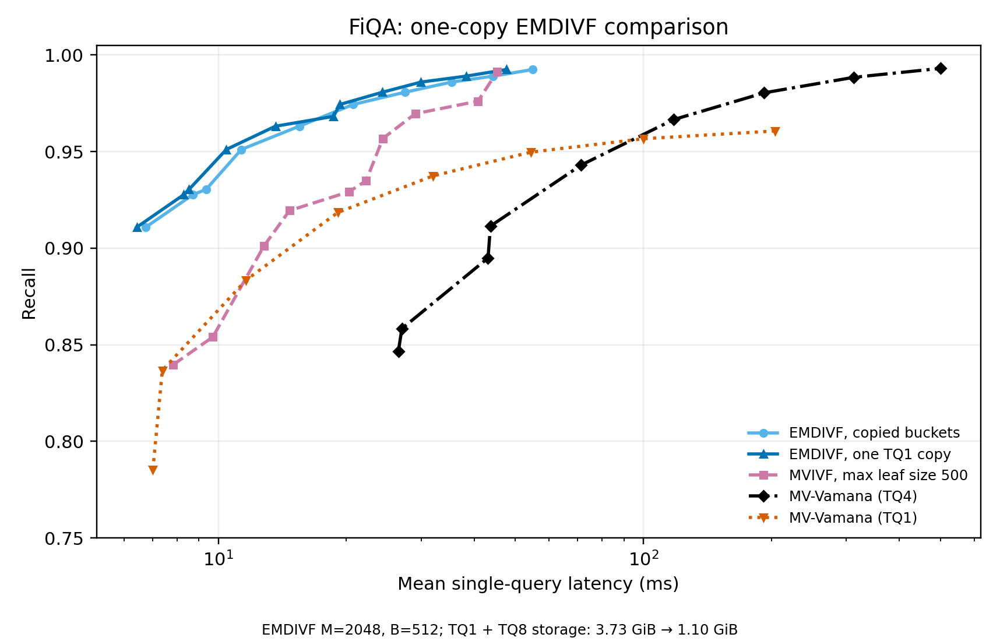
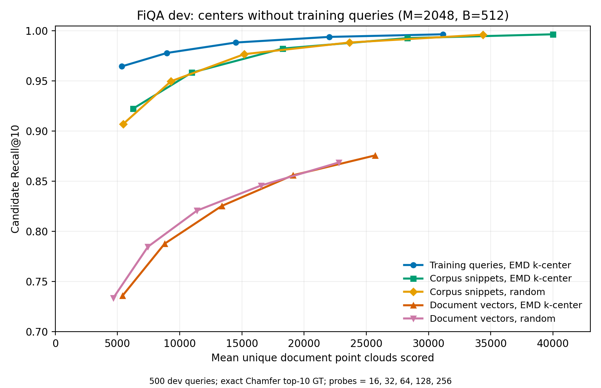
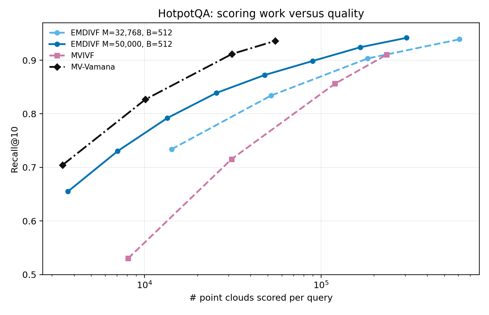

# EMDIVF exploration record

This consolidates the FiQA and HotpotQA experiments and the later build ideas.
Results below come from saved measurements. The repository cleanup did not run
new experiments. The current method is documented in
[`mvsic/emdivf/README.md`](../mvsic/emdivf/README.md); selected exploratory
tools live beside this report. Original trial scripts, full CSVs, logs,
indexes, and older notes remain under the ignored [`artifacts/`](artifacts/)
link, whose local target is `/ssd2/kishen/emdivf`.

## Algorithm and evaluation

The original algorithm selects actual training-query point clouds by seeded
farthest-first traversal under EMD. Each prototype stores its top-B document
IDs under query-to-document Chamfer. These fixed-size lists overlap. At search
time, routed prototypes contribute a union of documents which are scored and
ranked. Training-query assignments describe prototype coverage; they are not
the document buckets.

EMD is uniform-mass 1-Wasserstein distance with Euclidean vector ground cost.
The FiQA queries have 32 vectors of dimension 128, so exact EMD uses an
assignment solver. Unequal cardinalities use balanced transport without
padding or dropping vectors. Selection maintains only nearest-center distances,
not a full training-query pairwise matrix.

The standard fast search path uses a Chamfer Vamana graph over prototypes:
TQ4 graph routing, TQ8 Chamfer prototype reranking, one-copy TQ1 document
scoring, then the shared TQ8 Chamfer final reranker. Wards compression uses
threshold 0.5 for coarse routing/scoring; final reranking uses the original
query. EMD remains the prototype-selection metric; it is not the standard
final document score. FiQA's usual index has M=2,048 and B=512.

All retrieval recall here is against **exhaustive float Chamfer top-10**,
not BEIR relevance labels. Candidate recall counts true neighbors in the
candidate union; final recall counts returned neighbors after scoring and
reranking. Work plots exclude prototype routing and final reranking. The
original FiQA graph comparison counts distance calls, including repeated
scores; later HotpotQA plots use the exported graph-node work counter. These
are document-work diagnostics, not counts of every operation.

FiQA uses 500 dev and 648 test queries. The early parameter exploration also
examined test results and should be treated as exploratory. Later selections
used dev before test. HotpotQA uses reproducible samples of 256 dev and 512
test queries, rather than all 7,405 test queries. Most corrected latency
comparisons run sequential queries on NUMA node 0 of a Xeon Platinum 8160
without VNNI. Individual studies sometimes time 128-query subsets; their
absolute times are not interchangeable controlled measurements.

## 1. Prototype count, bucket size, multiple probes, and baselines

We explored M from 64 through 2,048, B in {512, 1,024, 2,048}, and multiple
probed prototypes. Comparisons include default MVIVF with max leaf size 500,
flat MVIVF, 10x/18x spill variants, and MV-Vamana. Increasing prototype count
was much more useful than simply increasing B; B=512 became the main setting.

| FiQA method/setting | Document scores/query | Exact top-10 candidate recall |
|---|---:|---:|
| EMDIVF M=256, B=1,024, 2 probes | 1,971 | 67.7% |
| EMDIVF M=2,048, B=512, 5 probes | 2,059 | 91.4% |
| MVIVF auto, max leaf 500, 17 leaves | 1,996 | 66.1% |
| MV-Vamana R=128, L=64 | 2,073 | 89.1% |

The M=2,048 setting reaches 95.1% coverage at 3,357 candidates and 97.2%
at 5,568. At the corresponding roughly 5,500-score point, MV-Vamana reaches
96.4% and default MVIVF 83.2%. These are candidate coverage measurements.

Farthest-first training-query covering radius decreases from 1.199 at M=256
to 1.117 at M=1,024 and 1.054 at M=2,048. The last setting has 828 singleton
training-query clusters, suggesting room for a density-sensitive selection
objective. Seeded random prototypes were also included in the initial runs;
random and farthest-first pools remain in the artifact results.

Sources: [`CANDIDATE_COMPARISON.md`](artifacts/CANDIDATE_COMPARISON.md),
[`results/fiqa_candidate_curve/`](artifacts/results/fiqa_candidate_curve/),
[`results/fiqa_test_random/`](artifacts/results/fiqa_test_random/).

## 2. Cluster spread and routing order

We distinguished the prefix of clusters chosen by center scores from a
GT-aware greedy cover that chooses whichever bucket contains the most
remaining exact neighbors. The latter is a diagnostic oracle, not a router.
For overlapping lists, a neighbor is encountered in its first containing list.

| FiQA method | Mean routed-prefix length for all top-10 | Mean greedy-cover lists for all top-10 |
|---|---:|---:|
| EMDIVF M=1,024, B=512 | 20.80 | 2.36 |
| EMDIVF M=2,048, B=512 | 22.02 | 1.93 |
| MVIVF default, leaves <=500 | 122.07 | 6.30 |
| MVIVF-Spill 10x, leaves <=500 | 108.06 | 3.85 |
| MVIVF-Spill 18x, leaves <=500 | 122.19 | 3.48 |
| MVIVF-Flat 10x, 1,024 lists | 20.35 | 2.02 |
| MVIVF-Flat 18x, 2,048 lists | 19.66 | 1.85 |

EMDIVF statistics condition on queries whose full top-10 is present somewhere
in the index. The greedy cover need not be the mathematically minimum set
cover. Its mean is different from the routed-prefix mean and from recall
after a fixed number of probes.

Similar spread does not imply similar scoring work: flat spill lists have
variable sizes and routing encounters useful lists at different ranks. In the
2,048-list comparison, the first EMDIVF bucket contains 67.05% of top-10 from
512 documents; the first flat 18x-spill list contains 49.71% from 753 documents.
Five EMDIVF lists reach 91.37% from 2,059 candidates; ten flat-spill lists
reach 91.08% from 5,512.

Sources: [`RESULTS.md`](artifacts/RESULTS.md),
[`CENTER_RANK.md`](artifacts/CENTER_RANK.md), and the candidate-curve CSVs.
Some older narrative files link superseded figure names; this report's
checked-in figures are the retained references.

## 3. Faster routing: EMD, Chamfer, and greedy matching

We built prototype Vamana graphs using exact EMD, Chamfer, and greedy
matching, and measured recovery of the exact EMD top-K prototypes for
K in {1, 2, 4, 8, 16}. We also searched with Chamfer, then reranked a
prototype shortlist with EMD or greedy matching.

At 16 probes, the early exact-EMD graph path took 55.29 ms for routing and
reached 96.30% retrieval recall. Chamfer shortlist64 plus EMD reranking took
6.39 ms for routing and reached 96.39%. Allocation reuse, rigorous EMD lower
bounds, exact small-graph seen tables, and reducing graph degree to 32 helped.
Precomputed vector norms, gathered GEMM shortlists, alternate Hungarian
arithmetic, prototype prefetch, degree16, centroid entry points, and copying
prototype clouds did not give a useful improvement.

Greedy matching sorts all vector-pair edges and accepts an edge when neither
endpoint has been matched. The optimized equal-cardinality kernel uses matrix
multiplication, radix sorting of squared costs, reusable workspaces, and square
roots only on accepted edges. It preserves that greedy algorithm, but is not
the optimal assignment. Standalone greedy routing became 10-16x faster;
16-probe routing fell from 133.82 to 11.68 ms at unchanged 96.27% recall.
For a shortlist64, greedy reranking took 1.28 ms versus exact EMD's 2.79 ms,
with 96.47% versus 96.39% recall. The later standard quantized path uses
TQ8 Chamfer for prototype reranking.

Source: [`results/fiqa_vamana_latency/README.md`](artifacts/results/fiqa_vamana_latency/README.md).

## 4. Quantization correctness and stage-by-stage checks

The initially large TQ8 quality loss was a correctness bug. The non-VNNI
fallback saturated intermediate integer dot products. Separate fixes exclude
padded vectors from maxima and propagate the configured rotation seed.
In a paired diagnostic with the same exact top-100 candidate pools, correcting
the arithmetic raised Recall@10 from 97.4074% to 99.7377%; mean absolute
Chamfer score error fell about 28.3x. These shared-kernel fixes matter for
other methods as well as EMDIVF.

We switched routing, prototype reranking, candidate scoring, final reranking,
and query compression individually to float/original queries. In the corrected
64-probe pipeline, final recall was 98.07%; float final rerank gave 98.33%,
float candidate scoring 98.47%, and disabling Wards gave 98.52%. Residual
quantization loss is much smaller than the original arithmetic bug.

The later controlled float/TQ1 comparison held each method's routes,
candidates, compression, and 500-document TQ8 final rerank fixed:

| Method/probes | Clouds/query | Float document stage | TQ1 document stage | Stage speedup | Total speedup |
|---|---:|---:|---:|---:|---:|
| EMDIVF / 8 | 3,059 | 55.45 ms | 3.33 ms | 16.6x | 4.7x |
| EMDIVF / 64 | 14,479 | 261.52 ms | 14.86 ms | 17.6x | 10.6x |
| MVIVF / 128 | 13,785 | 196.59 ms | 9.96 ms | 19.7x | 10.0x |
| MVIVF / 512 | 50,725 | 684.93 ms | 35.23 ms | 19.4x | 14.6x |

EMDIVF benefits strongly from quantization. Its smaller low-probe total
speedup reflects fixed routing/reranking costs after scoring becomes cheap.
At similar cloud counts it has a comparable total gain. Selected document
length also matters: FiQA averages 126.9 vectors/document, while EMDIVF's
top-512 bucket memberships average 166.9. These counts are population proxies,
not a matched-ID vector-work benchmark. EMDIVF times the first 128 test queries
in this diagnostic; MVIVF times a seeded random 128-query subset. A repeat
reproduced EMDIVF stages within 2%, while MVIVF float timing moved under load.

Sources: [`kernel audit`](artifacts/results/fiqa_quantization/kernel_audit/README.md),
[`quantization investigation`](artifacts/archive/repo_exploratory/fiqa_quantization_investigation/README.md).

## 5. Locality, overlap, and the one-copy layout

Copying every raw bucket used 83.47 GiB for FiQA B=512 and made scoring
slower. At 16 probes, indirect scoring took 121.89 ms, copied scalar scoring
163.15 ms, and whole-bucket batch scoring 251.19 ms. The batch path also
rescored overlapping documents. More locality alone did not offset that cost.

Quantized experiments compared full-bucket scoring then deduplication,
deduplication before scoring, adaptive dense/sparse scans, preprepared queries,
prefetching, shared blocks, and a single global panel store. Extracting shared
blocks of at least 32 documents represented 46.52% of memberships in shared
blocks and retained 76.74% of the old document-copy count; those are layout
statistics, not a demonstrated runtime result.

The promoted `direct512` path unions bucket IDs with a bitset, enumerates
documents in physical order, reuses one prepared TQ1 query, and scores the
shared prepacked panels. Approximately 128-KiB scheduling chunks and an
8-KiB lookahead prefetch up to 512 bytes of a future document. These chunks
are query-time scheduling units, not permanent shared blocks. Gathering panels
into temporary 64/128/256-KiB buffers was slower.

| FiQA probes, final rerank=500 | Final recall | Copied layout | One-copy layout |
|---|---:|---:|---:|
| 32 | 97.44% | 20.77 ms | 19.33 ms |
| 64 | 98.07% | 27.49 ms | 24.32 ms |
| 128 | 98.60% | 35.37 ms | 29.97 ms |
| 256 | 98.90% | 45.45 ms | 38.30 ms |

The paired layouts produced identical per-document scores, ordered shortlists,
and final results on the checked dev/test settings. Scan representation plus
bucket IDs decreased from 2.753 to 0.121 GiB; adding the unchanged TQ8 payload
gives 3.734 versus 1.102 GiB. RSS decreased from 7.55 to 4.77 GiB but includes
raw data and benchmark state. The graph and minor routing metadata are outside
the encoded-component sum.

At 32 probes the one-copy EMDIVF point gives 97.44% recall in 19.33 ms,
versus MVIVF's 96.96% in 29.07 ms at 256 probes. Final reranking costs about
9 ms for both. The plot also includes corrected MV-Vamana TQ4 and TQ1 search
with TQ8 reranking. TQ1 graph search improves middle-recall latency but
saturates around 96.06% at L=4,096 versus TQ4's 99.31%.

Sources: [`one-copy validation`](artifacts/results/fiqa_dynamic_scan/promotion_summary.json),
[`main comparison`](artifacts/results/fiqa_quantization/README.md),
[`raw locality`](artifacts/results/fiqa_locality/README.md).

## 6. Other search optimizations

| Experiment | Observed outcome |
|---|---|
| Less/no Wards routing compression | Little change in bucket coverage at fixed shortlist; no clear major gain. |
| Attach uncovered documents, cap bucket size at 522 | Top-three-center assignment with gap 0.05 places 2,362/2,398 orphans; 128-probe candidate recall changes only about 99.38% to 99.48%. |
| TQ4 stage between TQ1 and TQ8 | Preserved recall at a tested shortlist size but made 32-probe latency 20.80 to 22.52 ms. |
| Heap/early-bound scoring, reusable workspaces, shared layouts | Useful diagnostics; no replacement for the final direct512 path established. |
| `nth_element` shortlist selection | No material high-probe improvement over partial sorting. |
| Document sketches of 32/64 vectors | Faster but lose quality: at 256 probes/rerank500, about 98.94%/44.51 ms becomes 95.60%/19.41 ms or 97.92%/25.93 ms. |
| Software fused-popcount kernel | Preliminary 6-7% TQ1 and 1-4% total improvement; excluded from main comparison because other methods share the kernel. |
| Adaptive probing using GT | Oracle diagnostic only: about 7,822 versus 31,151 candidates at the same 99.66% coverage. Cannot be used online. |
| Practical overlap/diversity/budget routing | Tested 4k/8k/16k/24k candidate budgets and weights 0.025/0.1. Changes were small; at 16k, 98.16%/31.12 ms became 98.14%/30.34 ms in one comparison. |

Sources: [`round2`](artifacts/results/fiqa_optimization_round2/),
[`round3`](artifacts/results/fiqa_optimization_round3/),
[`high probes`](artifacts/results/fiqa_high_probes_v2/),
[`overlap routing`](artifacts/results/fiqa_overlap_routing/),
[`adaptive oracle`](artifacts/results/fiqa_adaptive_probe_oracle/).

## 7. Prototypes without training queries

We sampled 5,500 corpus documents and compared short snippets encoded through
ColBERT's **query encoder** against 32 selected original document vectors.
Each source was tested with random or EMD farthest-first selection at
M=2,048/B=512. Corpus prototype generation reads no observed queries or qrels.

| Source/selection | Dev final recall at 256 probes/rerank1000 | Latency | All-bucket candidate ceiling |
|---|---:|---:|---:|
| Training queries / farthest-first | 99.20% | 48.11 ms | 99.88% |
| Corpus query-encoded text / farthest-first | 99.20% | 53.54 ms | 99.98% |
| Corpus query-encoded text / random | 99.14% | 49.43 ms | 99.96% |
| Original document vectors / farthest-first | 87.40% | 47.22 ms | 90.96% |

At roughly 15,000 candidates, interpolation between measured settings gives
98.88% candidate recall for training-query centers, 97.16% for text
farthest-first, and 97.59% for random text. Query-encoded text is a practical
fallback when training queries are absent; original document vectors have a
coverage problem even before routing. Random text was competitive with EMD
selection on FiQA. Combining saved supervised/text bucket prefixes improves
the all-bucket ceiling by only 0.10 percentage points and was not a routed
hybrid-search experiment.

Source: [`corpus prototype pilot`](artifacts/results/fiqa_corpus_prototypes/FIQA_NO_TRAINING_QUERY_PILOT.md).

## 8. HotpotQA scale and build batching

Train/dev embeddings contain 85,000/5,447 queries, validated against the
existing model and separate official splits. The 5,233,329-document corpus
is reused. All serving experiments use one-copy encodings and B=512.

| Prototypes | Corpus represented in buckets | Dev top-10 coverage ceiling |
|---|---:|---:|
| 16,384 | 57.74% | 91.95% |
| 32,768 | 69.67% | 96.88% |
| 40,000 | 72.36% | 97.34% |
| 48,000 | 74.53% | 97.97% |
| 50,000 | 75.03% | 98.20% |

At M=32,768, documents have mean replication 3.21 across the whole corpus,
or 4.60 among represented documents. Nearly 30.33% occur in no bucket. The
completed M=50,000 extension improves coverage but does not solve candidate
efficiency:

At about 31k scored documents, MV-Vamana reaches 91.17% final recall while
M=50,000 EMDIVF is around 85%. At about 55k scores they reach 93.61% and
about 88%. Reducing B to 256 or 128 worsened the dev work/recall tradeoff;
near 50k candidates, B=512/256/128 gave roughly 85%/81%/76% recall.

Bucket construction scans the shared TQ8 corpus, then float-refines a
shortlist. It is approximate globally; float refinement alone does not prove
global exactness. Batch16 reduced a 64-bucket FiQA build from 1.344 to
0.975 seconds and a HotpotQA build from 59.721 to 36.978 seconds, with
identical ordered IDs versus batch1. The builder supports incremental,
resumable selection and bucket journals. Existing prefixes were reused
when extending the prototype count. Full 50,000-center HotpotQA bucket
construction still took about 30,409 seconds (8.45 hours).

Sources: [`initial HotpotQA`](artifacts/results/hotpotqa_onecopy/README.md),
[`incremental/batch study`](artifacts/results/batch_overnight/README.md).

## 9. Faster bucket construction attempts

The static parent-pool experiment builds k'=128 global enlarged lists, then
assigns each later prototype to one or a few early parents under EMD and
scores only their document union. At M=1,024/B=512 and 32 dev probes:

| Build setting | Candidate recall | Bucket build time |
|---|---:|---:|
| Global TQ8 scan plus float refinement | 97.26% | 12.79 s |
| 1 parent, B'=2,048 | 89.70% | 5.63 s |
| 1 parent, B'=4,096 | 93.82% | 10.92 s |
| 1 parent, B'=8,192 | 95.62% | 19.35 s |
| 1 parent, B'=16,384 | 96.60% | 35.17 s |
| 1 parent, B'=32,768 | 97.20% | 61.54 s |

The candidate counts are all about 10k per query. Two/four parents improved
quality but did not beat the global tradeoff. With B'=2,048, even an oracle
best parent retains only 39.6% of an M=2,048 child's true top-512; the best
four retain 71.4%. Small parent lists restrict candidates too severely.
The larger parent prefixes were exact or matched exact ordered IDs. Child
rescoring used scalar float Chamfer, so a better subset kernel could alter
times but cannot restore excluded documents. Times are single-pass, exclude
cache loading, and were not repeated under controlled host load. Full
recall-versus-candidate curves are saved; these runs did not time query search.

Two alternative candidate sources were checked:

- Existing document indexes: on 32 FiQA centers, MV-Vamana at L=2,048
  recovered 95.4% of top-512 while scoring 18,491 documents in 445 ms/center;
  MVIVF at 1,024 leaves recovered 90.9% from 22,358 in 428 ms/center. The
  batched global TQ8 builder took about 15.3 ms/center throughput for a
  64-center sample with exact bucket agreement. The execution schedules differ.
- Document-first assignment: assigning each document to its top 128 centers
  recovered 97.69% of saved memberships but created 14.07x the final postings.
  Its full center scan took 10.85 s versus the global bucket build's 12.79 s.

Sources: [`parent-pool results`](artifacts/archive/repo_exploratory/hierarchical_bucket_ablation/README.md),
[`document-index pilot`](artifacts/archive/repo_exploratory/emdivf_doc_ann_pilot/README.md).

## 10. Proposed next experiments: no dataset results yet

**Incremental prefix-doubling bucket construction.** Start with 128-256
globally built enlarged seed buckets. New prototypes search the current
index, build buckets from several routed reservoirs, then become available
to subsequent rounds. Use frozen snapshots for parallel rounds. This differs
from the tested static-parent build, whose later buckets never help one another.
Keep seed reservoirs enlarged initially; shrink added reservoirs with fixed,
inverse-square-root, or inverse-prefix-size schedules. Small ID-union checks
show seed128/top4096 contains 99.92% of FiQA dev neighbors and
seed256/top2048 contains 99.94%; these are support ceilings, not routed results.
No search can discover a document absent from every seed reservoir, so larger
datasets need periodic global anchors or another document candidate source.
Full doubling also needs explicit prototype-graph connectivity checks.

**Radius-based temporary reservoirs.** Retain candidates within a Chamfer
margin of the current B-th score, with size floors and hard caps. Keep final
serving buckets at B=512. Radius estimates from restricted candidates are
approximate; shrinking can erase reachable documents. No measured advantage
or implemented integrated builder has been established.

**Doubling D-squared prototype seeding.** Sample query prototypes using weights
equal to squared nearest-prototype EMD, update distances against each batch,
and grow batches. This emphasizes total query distortion rather than worst-case
radius. Ensure distinct selected queries, handle zero total weight, and cap
batches if stale weights select too many nearby centers. This is seeding using
actual query clouds, without EMD barycenters. Compare its prototypes using
global buckets before combining it with approximate bucket construction.

Other untested directions include a cheaper TQ1/TQ4 global shortlist before
TQ8/float refinement and token-level document candidate generation. These
remain proposals, not positive results.

The retained [`prefix_build/`](prefix_build/) contains only a router and
plotting draft. It has no completed FiQA bucket-build run, radius experiment,
or D-squared selection result.

## Retention and migration

- `mvsic/emdivf/` contains the runnable C++ method and its build declarations.
- `emdivf_experiments/` contains selected maintained exploratory source,
  embedding helpers, this report, and the selected figures above.
- The old `emdivf` and `experiments/emdivf` directory symlinks are replaced by
  the single ignored `emdivf_experiments/artifacts` link.
- The old `experiments/{hierarchical_bucket_ablation,emdivf_doc_ann_pilot,
  fiqa_quantization_investigation,emdivf_prefix_build}` trees and the previous
  combined study are preserved under `artifacts/archive/repo_exploratory/`.
- Original trial scripts and all saved results remain on SSD for recovery.
  Superseded scripts are not required to compile or run the cleaned method.

No measurements were removed. The relocation has not been compiled or
benchmarked during this cleanup because the machine is busy; historical
timings must not be presented as validation of the reorganized binaries.
